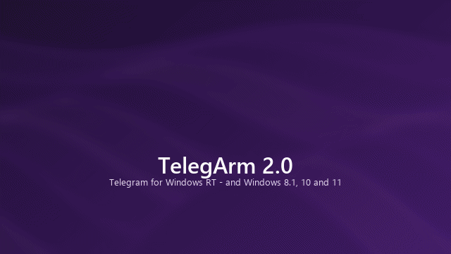

# TelegArm

TelegArm is a Telegram client for Windows RT 8.1 and Windows 10 ARM32. The official Telegram apps don't run on
these devices anymore, so I made this one. It runs on normal Windows PCs too.

It's written in C# (WinForms) and talks to Telegram with WTelegramClient. Calls and voice chats use Telegram's own
call library (tgcalls), built for ARM32 and x86.

## Download

Get the latest version from the [Releases](https://github.com/hamed7ir/TelegArm/releases) page.

- `TelegArm-2.0.0-Setup.exe` installs it.
- `TelegArm-2.0.0-Portable.zip` runs without installing.

## Runs on

- Windows RT 8.1 (Surface and Surface 2). You need the RT jailbreak to run desktop apps.
- Windows RT 8.0. It needs the .NET 4.8 update, which is hard to find for RT 8.0.
- Windows 10 ARM32 (build 15035)
- Windows 8.1, 10 and 11 (x86, x64 and ARM64)
- Windows 7: not tested yet, and calls don't work there.

One build (AnyCPU) runs on all of them.

## Before you install: .NET Framework 4.7

TelegArm needs .NET Framework 4.7 or newer. Without it the app won't start, and Windows won't tell you why.

- Windows RT 8.1 comes with .NET 4.5, so install 4.7 first: https://go.microsoft.com/fwlink/?linkid=2088632
- Windows 10 ARM32 already has it.
- Windows 8.1, 10 and 11 usually have it. If TelegArm doesn't start, install it from the link above.

The installer checks .NET for you and gives you the link if it's missing. The portable version can't check, so
install .NET first.

## What it can do

- Log in with your phone, 2FA or a QR code. Use more than one account.
- Chats, groups and channels with live updates, search, folders, pinned messages, reactions, polls, bots and admin tools.
- Voice calls, video calls and group voice chats. The camera works on the Surface RT too.
- Photos, videos, GIFs, music and voice notes. Animated stickers and color emoji.
- Send photos, videos and files. Record voice notes and round videos.
- Downloads you can pause, resume and cancel.
- Persian and Arabic text goes right to left.
- Light and dark themes, any accent color, chat backgrounds and a wallpaper background for the window.
- Sharp at any display scale, and you can change the size live (Ctrl+= and Ctrl+-).
- One column on small screens. Made for touch and the on-screen keyboard.
- Proxies: MTProto, SOCKS5 and a built-in WebSocket tunnel.

## Build it yourself

You need Visual Studio 2017, .NET Framework 4.7 and C# 7.3.

1. Clone the repo.
2. Get your own Telegram API keys (api_id and api_hash) at https://my.telegram.org/apps
3. In `TelegArm/Core/`, copy `ApiCredentials.Local.cs.example` to `ApiCredentials.Local.cs` and put your keys in
   it. This file is ignored by git, never commit it. Without it the app builds but can't log in.
4. Build the solution (Debug or Release, AnyCPU). NuGet gets the packages.

Everything else the app needs (FFmpeg, the call library, rlottie, emoji and fonts) is in the repo and gets copied
next to the exe when you build. How the native parts are built: `third-party/ffmpeg`, `third-party/rlottie` and
`third-party/tgcalls`.

## License

TelegArm is GPL-3.0-only, see [LICENSE](LICENSE). The libraries it uses keep their own licenses, see
[THIRD-PARTY-NOTICES.txt](THIRD-PARTY-NOTICES.txt).

## Credits

Built on [WTelegramClient](https://github.com/wiz0u/WTelegramClient) by Wizou. Calls use Telegram's
[tgcalls](https://github.com/TelegramMessenger/tgcalls). Made with help from Claude (Anthropic).
